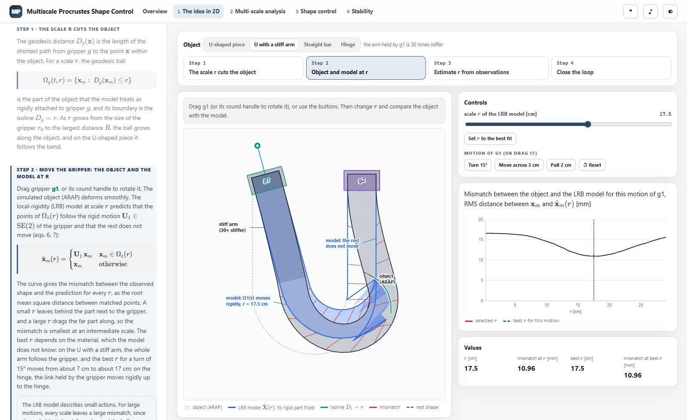
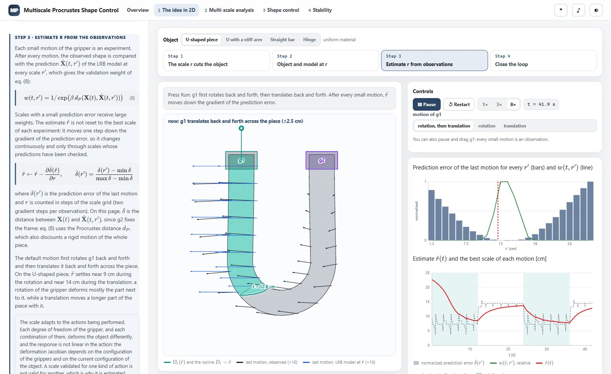
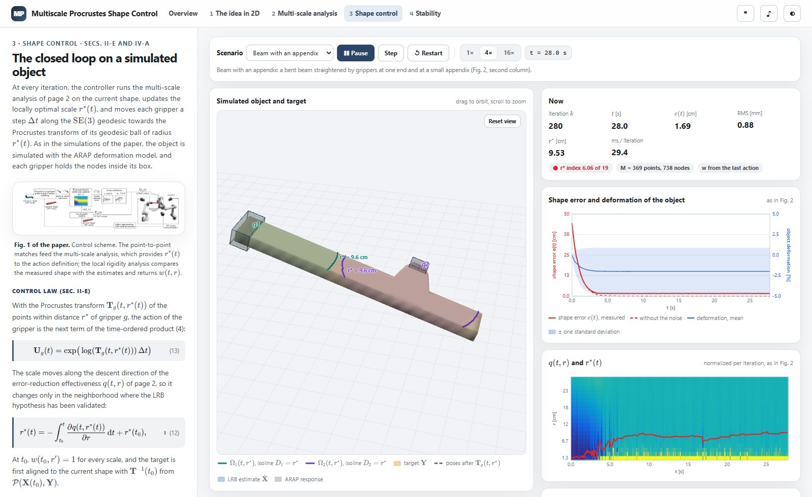

# Multiscale Procrustes-Based 3-D Shape Control

Interactive demos and code of the paper *Multiscale Procrustes-Based 3-D Shape Control*, by I. Cuiral-Zueco and G. López-Nicolás, IEEE/ASME Transactions on Mechatronics, 29(3), 2024.

### **[▶ Open the interactive demos](https://ignaciocuiral.com/Multi-scale-Procrustes-based-3D-shape-control/)**

[Web version of the paper](https://ignaciocuiral.com/Multi-scale-Procrustes-based-3D-shape-control/paper/) · [Video](https://www.youtube.com/watch?v=a2cZTjaVBmM) · [Paper (doi:10.1109/TMECH.2023.3325934)](https://doi.org/10.1109/TMECH.2023.3325934)

[](https://ignaciocuiral.com/Multi-scale-Procrustes-based-3D-shape-control/intro.html)

The method controls the 3D shape of texture-less deformable objects held by robots, without a model of the object and without an initial exploration of its behavior. The points of the perceived mesh are matched to the target mesh with functional maps. For each gripper and each scale *r*, a geodesic distance to the gripper, the Procrustes analysis of the points within distance *r* gives the rigid motion that would align them with their targets. The controller estimates which of these motions reduces the shape error, validates the estimates against the measured response of the object (the local-rigidity behavior), and moves the grippers along SE(3) geodesics at a locally optimal scale *r\**(t).

## Interactive demos

The demos run in the browser, with no installation. They compute the method on objects simulated with ARAP, as in the simulations of the paper, and every page shows the equations it computes next to the simulation.

| Page | Content |
|---|---|
| [Overview](https://ignaciocuiral.com/Multi-scale-Procrustes-based-3D-shape-control/) | The method in brief, the video of the paper, its figures, and the code. |
| [1 · The idea in 2D](https://ignaciocuiral.com/Multi-scale-Procrustes-based-3D-shape-control/intro.html) | Flat pieces moved in the plane, in four steps: how the scale *r* cuts the object into a rigid part and a rest; the local-rigidity model at *r* against the simulated object for a motion of a gripper; the estimation of *r* from the observed responses to small motions; and the closed loop in SE(2). Four pieces: a U shape, the U with a stiff arm, a straight bar, and a hinge. |
| [2 · Multi-scale analysis](https://ignaciocuiral.com/Multi-scale-Procrustes-based-3D-shape-control/analysis.html) | Secs. II-A to II-D at any instant of the 3D closed loop: the Procrustes transform of every geodesic ball, the estimate of the model for an action scale *r* and an influence scale *r'*, the error increments ê(t, r, r'), their validation w(t, r'), and q(t, r). |
| [3 · Shape control](https://ignaciocuiral.com/Multi-scale-Procrustes-based-3D-shape-control/control.html) | Secs. II-E and IV-A: the closed loop on five 3D objects (the four simulations of Fig. 2 and the triangle of the experiments), with the isolines of *r\**, the gripper poses that the Procrustes transforms prescribe, the model estimate against the simulated response, and the plots of Fig. 2. |
| [4 · Stability](https://ignaciocuiral.com/Multi-scale-Procrustes-based-3D-shape-control/stability.html) | Sec. III: the rotation and translation terms of the Lyapunov derivative along the closed loop, the functions of the lemmas, and an unreachable target for the remark on under-actuation. |

<p align="center">
  <a href="https://ignaciocuiral.com/Multi-scale-Procrustes-based-3D-shape-control/intro.html"></a>
  <a href="https://ignaciocuiral.com/Multi-scale-Procrustes-based-3D-shape-control/control.html"></a>
</p>

**What is simulated.** Each object is a cut-out piece discretized as a lattice of nodes and deformed with ARAP (Sorkine and Alexa, 2007); the grippers hold the nodes inside their boxes. The perceived points are the top surface of the piece, with 0.5 mm of measurement noise by default. Initial and target shapes come from the same simulator, so the matches between current and target points are known; in the paper, the functional maps of ZoomOut provide them from the perceived meshes.

**Implementation choices.** The pages follow the equations of the paper. Where the reference MATLAB code differs, the page *Shape control* offers both versions under *Implementation variants*:

- q(t, r) integrates ê(t, r, r') over the influence scale *r'*, as in eq. (11); the reference code sums over the action scale *r*, which keeps *r\** at larger scales and, in these simulations, reduces the error more slowly.
- The estimate of the model adds the increments of the grippers, as the reference code does, instead of the average (1/G)Σ of eq. (9).
- As in the reference code, the residual of the validation (8) is divided by the number of points, and q is normalized by its largest magnitude before the gradient step (12).

On the 2D page, steps 2 and 3 measure the mismatch between object and model as the distance between matched points (the fixed gripper g2 fixes the frame), while eq. (8) uses the Procrustes distance; step 4 runs the method as written.

### Run the demos locally

The pages are static files in `docs/`, with KaTeX and three.js included; any web server works, and GitHub Pages serves them from this folder.

```bash
python run.py                  # serves docs/ and opens http://127.0.0.1:8765/ (Python standard library only)
python tools/build_web.py      # after editing the sources in docs/ (needs Node.js; npx fetches esbuild)
node tests/test_sim.mjs        # checks of the simulation modules (Node.js, about 40 s)
```

Each page is a single HTML file that contains its style sheets, scripts, and figures: the build fills the blocks marked `data-inline` from the ES modules and the style sheet, so that a page also opens from the disk.

| Path | Content |
|---|---|
| `docs/*.html` | The pages and their lesson text. |
| `docs/js/sim/` | The method and the simulator: Procrustes operator, SE(3) logarithm and geodesics, geodesic distances by fast marching, ARAP with Anderson acceleration, the multi-scale Procrustes controller, the scenarios, and the terms of the stability analysis. These modules also run in Node.js. |
| `docs/js/lib/`, `docs/js/pages/` | The 3D view (three.js), the 2D canvas, the charts, the controls, and one module per page. |
| `docs/img/`, `docs/video/` | Figures and video of the paper. |
| `docs/paper/` | The web version of the paper. |
| `tools/`, `tests/` | The build script and the checks of the simulation modules. |

## MATLAB implementation

The MATLAB implementation of the paper (`main.m`, `multiscaleprocrustescontrol.m`) runs one simulation with ARAP on the meshes of `cuiral-meshes/` and their precomputed surface map, plots the current and target shapes, the shape error with the deformation of the object, and q(t, r) with r\*(t), and writes a video of the run.


It requires MATLAB (R2022b recommended) with the Statistics and Machine Learning Toolbox and the Computer Vision Toolbox, [iso2mesh](http://iso2mesh.sf.net), and [gptoolbox](https://github.com/alecjacobson/gptoolbox). The utilities in `dependencies.zip` are the mesh-analysis utilities of the [ZoomOut implementation](https://github.com/llorz/SGA19_zoomOut/tree/master/utils), with slight modifications. To run it, put iso2mesh and gptoolbox on the MATLAB path, extract `dependencies.zip` into the repository folder, and run `main.m` from that folder (it adds the subfolders to the path).

A Python port with a Polyscope viewer is in `python/` (see `python/README.md`).

## Citation

If you find this work useful, please cite:

> I. Cuiral-Zueco and G. López-Nicolás, "Multiscale Procrustes-Based 3-D Shape Control," *IEEE/ASME Transactions on Mechatronics*, vol. 29, no. 3, pp. 1738-1748, 2024, [doi: 10.1109/TMECH.2023.3325934](https://doi.org/10.1109/TMECH.2023.3325934).

```bibtex
@ARTICLE{10311090,
  author = {Cuiral-Zueco, Ignacio and López-Nicolás, Gonzalo},
  title = {Multiscale Procrustes-Based 3-D Shape Control},
  journal = {IEEE/ASME Transactions on Mechatronics},
  year = {2024},
  volume = {29},
  number = {3},
  pages = {1738-1748},
  doi = {10.1109/TMECH.2023.3325934}
}
```

## Authors

- [Ignacio Cuiral-Zueco](https://ignaciocuiral.com/)
- [Gonzalo López-Nicolás](http://webdiis.unizar.es/~glopez)

Instituto de Investigación en Ingeniería de Aragón (I3A), Universidad de Zaragoza, Spain.

## License

This repository is released under the Creative Commons Attribution-NonCommercial 4.0 International License (see `LICENSE`). The ZoomOut utilities in `dependencies.zip` come from the [ZoomOut repository](https://github.com/llorz/SGA19_zoomOut); KaTeX and three.js keep their MIT licenses (`docs/vendor`); and the optional background music of the demos keeps the licenses listed in `docs/audio/CREDITS.md`.

## Acknowledgements

This work was supported through Project REMAIN S1/1.1/E0111 (Interreg Sudoe Programme, ERDF), Project PID2021-124137OB-I00, and Project TED2021-130224B-I00 funded in part by MCIN/AEI/10.13039/501100011033, in part by the ERDF A way of making Europe, and in part by the European Union NextGenerationEU/PRTR.


The interactive demos were developed with the assistance of Claude (Anthropic), an AI model, which wrote and tested the code and drafted the text of the pages under the direction of the authors.
